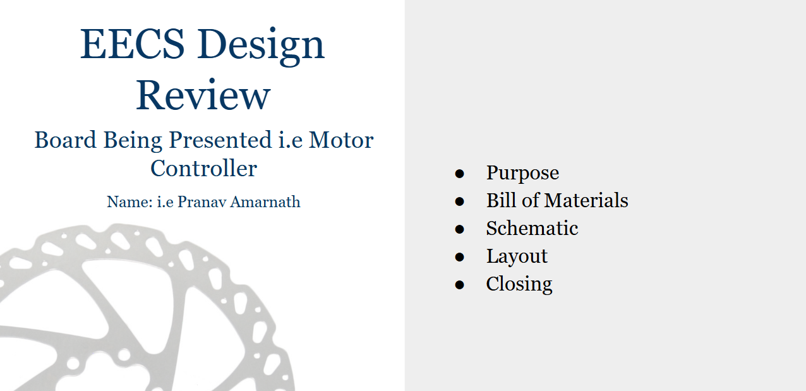

# Section 7: Design Review Presentation

To wrap up the training, you will give a short design review of your board at the start of our next general meeting on Wednesday, October 7th at 8:00pm. This is low-pressure. The goal is simply to walk the team through what you built and the choices you made.

## Make your slides

Make your own copy of the template here: [Design Review Template](https://docs.google.com/presentation/d/1krUgTue7rsLhpPNajoR8OOEfo2dnk1q5QFV_eG8hcVI/edit?usp=sharing) (File > Make a copy), then fill it in with your board.

Your presentation should cover:
- Purpose: what your board does (the e-bike motor driver).
- Bill of Materials: the main parts you used.
- Schematic: your circuit and the design choices behind it.
- Layout: your PCB layout and why you placed and routed things the way you did.
- Closing: what you learned and what you would do differently next time.

## Before the meeting: schematic first draft by Tuesday

PCB design is hard, so I want to see your work before you present. Have a first draft of your schematic done by Tuesday (October 6th) and send it to me. I will give you feedback, and you will present the second revision at the meeting.

### That is it. Good luck, and have fun with it!
